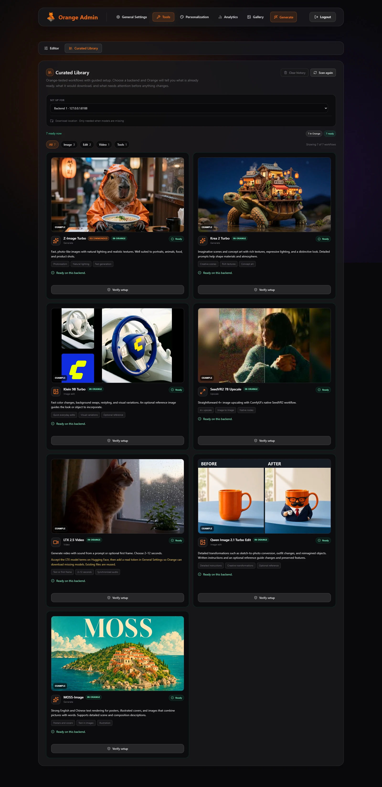
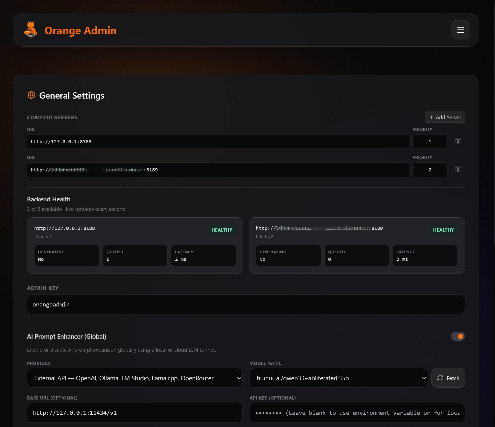

# Orange 😼

<p align="center">
  
</p>

Orange is a small, local-first media generation frontend for **ComfyUI and cloud APIs**. It turns finished workflows and API models into simple tools that people can use without seeing the node graph, model setup, or backend details.

> **Smarter internals, simpler surface.**

ComfyUI is where the workflow gets built. Orange is where people use it.

## Highlights

- **Simple generation UI.** Show people the controls they actually need, like a prompt, reference image, or aspect ratio.
- **Native cloud generation.** Create curated image and video tools with Google, OpenAI, OpenRouter, Venice, xAI, Runway, and fal.ai. Keep credentials server-side and store results locally; ComfyUI is optional.
- **Bring your own workflows.** Orange works with image generation, editing, upscaling, video, audio, and text workflows exported from ComfyUI.
- **Preflight and portable models.** Check nodes, mappings, and assets; resolve model folders per backend and remember explicit choices for duplicate filenames.
- **Optional curated tools.** Filter the library for image, editing, video, utility, or API tools. Reuse compatible installed ComfyUI models or add a cloud preset.
- **Prompt enhancement and personalization.** Add local or cloud LLM prompt enhancement, themes, and white-label branding when you want them.
- **Run it your way.** Connect to an existing ComfyUI setup, or use the Pinokio launcher to install Orange and ComfyUI together.

## Cloud generation in v1.2

Connect a provider under **Admin → General Settings → API Keys**, then add **Nano Banana 2.1** or **GPT Image 2.6 Flare** from **Tools → Curated Library → API**. Both presets generate from a prompt and accept an optional image for editing. Use **Create API Tool** to curate controls for other supported image and video models.

See the [v1.2.0 release notes](CHANGELOG.md#v120---2026-11-20) for details. To upgrade, select **Update Orange** in Pinokio or update a manual checkout, then restart Orange.

## Install

### Pinokio

The easiest all-in-one setup is the companion [Orange Pinokio launcher](https://github.com/saintbrodie/orange-pinokio).

It offers two install paths:

- **Orange + ComfyUI** installs and manages a local ComfyUI alongside Orange.
- **Orange Only** supports cloud-only setup or an existing ComfyUI instance from Stability Matrix, another manager, another machine, or a remote server.

Pinokio does not download workflow models up front. Orange checks the connected ComfyUI first and only installs missing files for tools you choose.

### Manual / GitHub

You need Python 3 and either a cloud API credential or a reachable ComfyUI instance.

Clone the repository, then start Orange:

```text
Windows:     run.bat
Linux/macOS: ./run.sh
```

Open `http://localhost:7070/`.

The launchers create the Python environment, sync dependencies when needed, keep routine logs quiet, and show useful generation and LLM activity in the terminal. Set `ORANGE_VERBOSE_LOGS=1` if you want full live logs.

### Change access mode or port

Open **Admin → General Settings → System Management**, choose an **Access mode** and **Port**, then click **Save Settings** and **Restart Server**. Orange shows the active settings separately from the saved values. If you change the port behind a reverse proxy, update the proxy's upstream to the new port.

On a trusted private network, you can also enable **Allow HTTP access from the private LAN** before saving and restarting. It allows remote Admin in Open LAN and lets Team members sign in directly from another device. Open LAN Admin accepts the configured **Admin Key**, including the factory key, on direct LAN HTTP connections when this option is enabled. Passwords and session cookies travel unencrypted on HTTP.

The Orange launcher reads saved listener settings from `runtime/listener.json` on each start. `ORANGE_ACCESS_MODE`, `ORANGE_PORT`, and `ORANGE_ALLOW_LAN_HTTP=1` supply initial settings before anything is saved in Admin. When running Uvicorn directly, configure the bind address, port, and environment with your service manager, or switch to the Orange launcher to apply the saved settings.

### Share Generate on a LAN

Orange starts in **Local** mode. To share it on a trusted private network, complete setup on the Orange host, then select **Open LAN** in System Management and restart. Before saving listener settings, you can also start with `ORANGE_ACCESS_MODE=open-lan`.

```powershell
$env:ORANGE_ACCESS_MODE = "open-lan"
.\run.bat
```

```sh
ORANGE_ACCESS_MODE=open-lan ./run.sh
```

Guests can open Orange using the host's LAN IP, computer name, or fully qualified DNS name when it resolves on their network. Use port `7070` or the port you saved in System Management. Orange keeps job status and results scoped to the guest's browser. The browser cookie lasts 30 days. On the Orange host, open `/admin` using localhost or the host's own LAN address or DNS name, then sign in with your Admin password. Admin access from another device uses HTTPS by default. Keep ComfyUI itself private to Orange if several people share a backend.

Open LAN exposes configured ComfyUI tools by default. Set `ORANGE_LAN_TOOLS` to a comma-separated list of tool IDs to choose the exact tools guests can run, including any paid cloud tools. An empty list disables all guest generation. Set `ORANGE_LAN_PROMPT_ENHANCEMENT=1` if guests should use the configured prompt enhancer. Apply spending limits at the provider when allowing paid tools. Set `ORANGE_LAN_HOSTS` to a comma-separated list of any custom DNS aliases you also want Orange to accept.

Existing installs that relied on LAN access need to opt in after upgrading. Keep `runtime/job-access.db` in host backups to preserve Open LAN job ownership. Admin's usage database backup and restore apply to the usage and cloud job database.

### Run Orange with Team accounts

Complete first-run setup, then open **Admin → General Settings → System** and select **Team** under **Access mode**. For a new team, enter the owner's username and password under **First Team owner**. Click **Save Settings** and **Restart Server**. If System Management shows that the running launcher predates Team LAN access, stop and relaunch Orange to apply the saved settings.

For headless setup, run `python -m scripts.team_owner owner` from the Orange folder using its virtual environment. You can set `ORANGE_ACCESS_MODE=team` before the launcher has saved listener settings.

Use **Admin → Personalization → Team sign-in** to edit the sign-in title, welcome message, button label, and form icon. The sign-in page uses the active theme and can display the app logo.

In Team mode, **Admin** is available to Owners and includes a **Team** tab. Operators use the Team page directly to manage their assigned account features.

On **Generate**, expand **My generation history** to check your jobs and open completed results.

At `http://localhost:7070/team`, sign in and open **Account Management** to create invite links. Owners can choose any role, and Operators can invite Members. Set the expiration date and time in your local time zone. Multiple recipients can use the same link before it expires, and each chooses their own username and password. Owners can reset passwords, and Operators can reset Member passwords. Issuing a password reset signs that account out and creates a one-time link that expires after 24 hours. Promoting a Member requires a fresh password from an Owner-issued link. Owners and Operators can manage member budgets. Each account can track and retrieve its own jobs under **My generations**.

Use **Add user** to set a username and password for an account that can sign in immediately. Owners can add and remove accounts at any role as long as at least one active Owner remains. Operators can add and remove Members. Removing an account revokes its sessions and password reset links, frees its username, and preserves historical workspace spending.

**Account Management** shows each account’s teams, date added, and recorded generation count. Search by username, filter by team, role, or status, and sort using the column headings. The directory displays 25 accounts per page by default. Dates are recorded for new accounts, and earlier accounts with no stored creation date display **Unknown**. Select a username to see recent activity, tool access, and account settings. Owners can open every account. Operators can open Member accounts and their own account. Prompts and generated files are available to the submitting account.

Owners control workspace-wide availability for Team mode in **Admin → Tools**. Under **Team → Teams**, create teams such as Graphics or Social Media and set their tool access. Click a team’s member count to filter the account directory. In **Account Management**, select individual users, a page, or all matches, then use **Manage teams** to add, remove, or move memberships. Moving users preserves their other teams. An account inherits tools from all of its teams. An account without a team inherits every globally available tool. Per-account overrides can allow or deny individual tools, subject to workspace-wide availability.

For HTTPS access to Team Orange, put a reverse proxy in front of the loopback launcher. Set `ORANGE_TEAM_ORIGIN` to the exact HTTPS origin, such as `https://orange.example.com`, and `ORANGE_TEAM_PROXY_IPS` to the proxy's explicit address, typically `127.0.0.1`. Have the proxy preserve `Host`, replace forwarded headers with trusted values, forward the HTTPS scheme, and pass server-sent events without buffering. For direct private-LAN access, enable LAN HTTP in System Management. Create invitations from the address members will use.

Expand **API usage and budgets** in **Team** to set the workspace's monthly USD budget and a cost estimate for each cloud tool. New workspaces start with a zero-dollar workspace limit. Estimate the highest-cost configuration a tool exposes. Orange reserves the estimate before dispatch, updates it when the provider reports a USD charge, and tracks estimates separately for providers that omit a charge. Budgets reset on UTC month boundaries. Team prompt enhancement uses Orange's managed local model.

The host recovery command is `python -m scripts.team_owner <username> --recover` using the Orange virtual environment. It resets that owner's password and revokes their active sessions. For a host backup, stop Orange and keep `runtime/job-access.db`, `usage_logs.db`, `runtime/media/`, the active workflow configuration and assets, and any needed ComfyUI output storage together. The Team web UI keeps legacy history and raw database backup controls out of member access.

## First run

A fresh install opens a setup wizard. If you connect ComfyUI, Orange scans the hardware, nodes, and model inventory, then lets you choose curated tools. Orange shows missing model downloads before installation and runs Workflow Preflight before adding selected tools to Generate.

For a cloud-only installation, select **Use cloud APIs only** during setup. You can also add API tools to an installation that already uses ComfyUI. See [API Providers](docs/API_PROVIDERS.md) for credentials, model discovery, and retry behavior.

Give Generate access only to people you trust to use your connected provider accounts. If a cloud result fails to download and **Retry download** appears, use it to retrieve the existing result without starting another generation.

You can add curated tools later from **Admin → Tools → Curated Library**, or import your own API-format ComfyUI workflows.

## A quick look

<table border="0">
  <tr>
    <td align="center"><a href="docs/screenshots/setup.webp"></a></td>
    <td align="center"><a href="docs/screenshots/curated-library.webp"></a></td>
    <td align="center"><a href="docs/screenshots/preflight.webp"></a></td>
  </tr>
  <tr>
    <td align="center"><b>First-run setup</b></td>
    <td align="center"><b>Curated Library</b></td>
    <td align="center"><b>Workflow Preflight</b></td>
  </tr>
  <tr>
    <td align="center"><a href="docs/screenshots/tools.webp"></a></td>
    <td align="center"><a href="docs/screenshots/personalization.webp"></a></td>
    <td align="center"><a href="docs/screenshots/settings.webp"></a></td>
  </tr>
  <tr>
    <td align="center"><b>Tool Editor</b></td>
    <td align="center"><b>Personalization</b></td>
    <td align="center"><b>General Settings</b></td>
  </tr>
</table>

## Documentation

- [Architecture Overview](docs/ARCHITECTURE.md)
- [API Providers & Cloud Generation](docs/API_PROVIDERS.md)
- [Adding Your Own Workflows](docs/adding_workflows.md)
- [Curated Workflow Packs](docs/WORKFLOW_PACKS.md)
- [Managed ComfyUI Lifecycle](docs/MANAGED_COMFYUI.md)
- [Managed Prompt Enhancement](docs/MANAGED_PROMPT_ENHANCEMENT.md)
- [Personalization & White-Label Branding](docs/PERSONALIZATION.md)
- [Changelog](CHANGELOG.md)

## License

Orange is released under the [MIT License](LICENSE).

Third-party components and model weights keep their own licenses. The curated workflow packs can download models with terms that are more restrictive than Orange itself, so check [Third-party notices](THIRD_PARTY_NOTICES.md) before using a pack commercially.

## Project direction

Orange should make ComfyUI workflows and cloud models easier to use. Administrators curate the controls for each tool so the Generate page stays focused on the choices people need for that tool.
