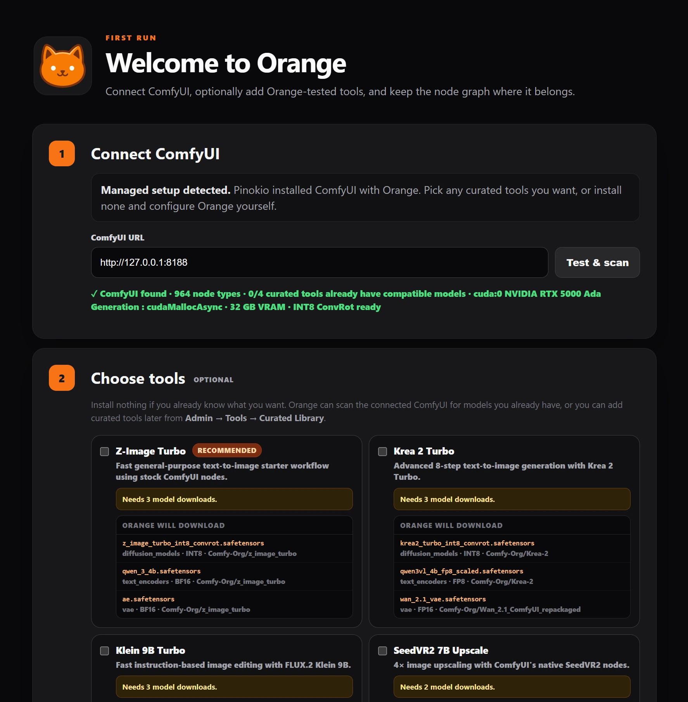
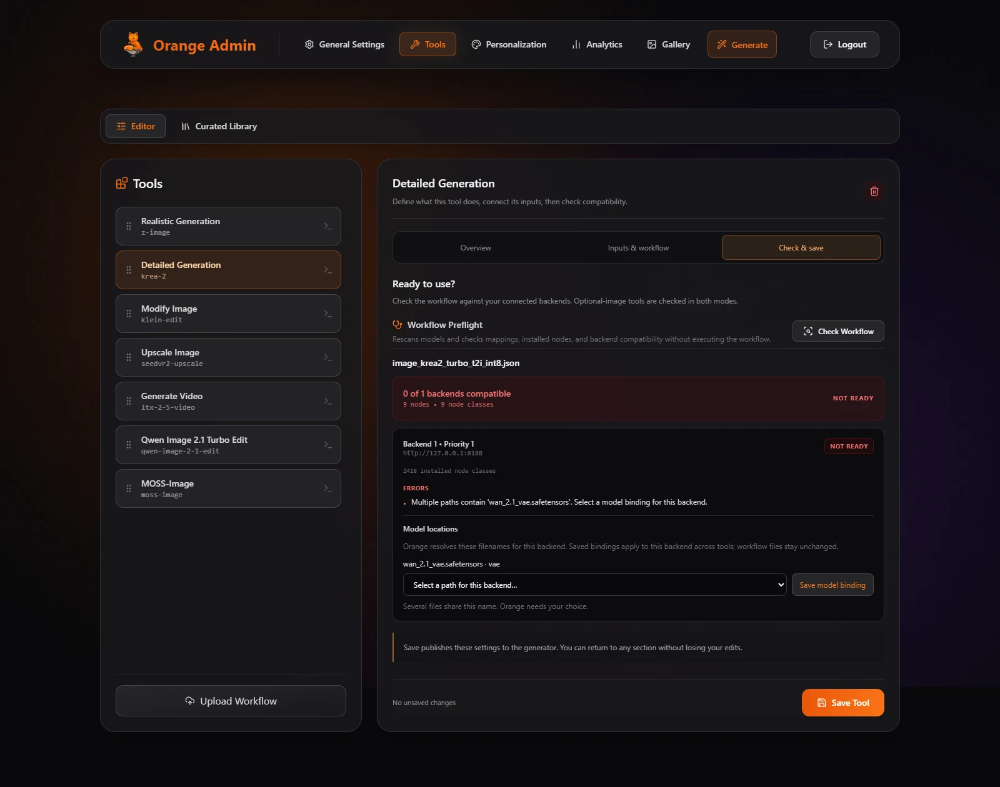
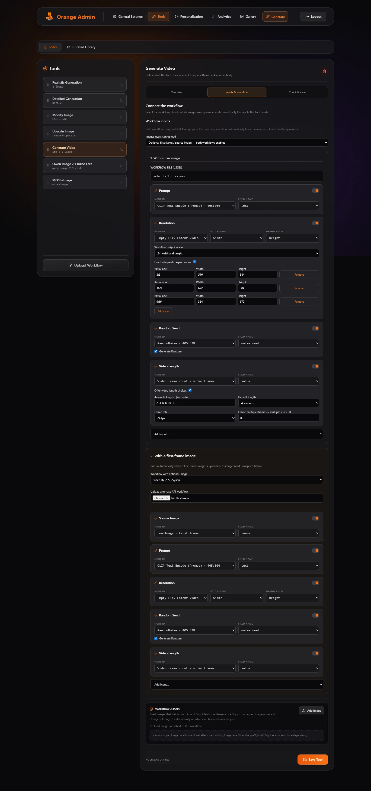
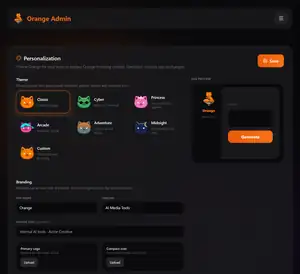

# Orange 😼

<p align="center">
  
</p>

Orange is a small, local-first media generation frontend for **ComfyUI and cloud APIs**. It turns finished workflows and API models into simple tools that people can use without seeing the node graph, model setup, or backend details.

> **Smarter internals, simpler surface.**

ComfyUI is where the workflow gets built. Orange is where people use it.

## Highlights

- **Simple generation UI.** Show people the controls they actually need, like a prompt, reference image, or aspect ratio.
- **Native cloud generation.** Create curated image and video tools with Google, OpenAI, OpenRouter, Venice, xAI, Runway, and fal.ai. Keep credentials server-side and store results locally; ComfyUI is optional.
- **Bring your own workflows.** Orange works with image generation, editing, upscaling, video, audio, and text workflows exported from ComfyUI.
- **Preflight and portable models.** Check nodes, mappings, and assets; resolve model folders per backend and remember explicit choices for duplicate filenames.
- **Optional curated tools.** Filter the library for image, editing, video, utility, or API tools. Reuse compatible installed ComfyUI models or add a cloud preset.
- **Prompt enhancement and personalization.** Add local or cloud LLM prompt enhancement, themes, and white-label branding when you want them.
- **Run it your way.** Connect to an existing ComfyUI setup, or use the Pinokio launcher to install Orange and ComfyUI together.

## Cloud generation in v1.2

Connect a provider under **Admin → General Settings → API Keys**, then add **Nano Banana 2.1** or **GPT Image 2.6 Flare** from **Tools → Curated Library → API**. Both presets generate from a prompt and accept an optional image for editing. Use **Create API Tool** to curate controls for other supported image and video models.

See the [v1.2.0 release notes](CHANGELOG.md#v120---2026-11-20) for details. To upgrade, select **Update Orange** in Pinokio or update a manual checkout, then restart Orange.

## Install

### Pinokio

The easiest all-in-one setup is the companion [Orange Pinokio launcher](https://github.com/saintbrodie/orange-pinokio).

It offers two install paths:

- **Orange + ComfyUI** installs and manages a local ComfyUI alongside Orange.
- **Orange Only** supports cloud-only setup or an existing ComfyUI instance from Stability Matrix, another manager, another machine, or a remote server.

Pinokio does not download workflow models up front. Orange checks the connected ComfyUI first and only installs missing files for tools you choose.

### Manual / GitHub

You need Python 3 and either a cloud API credential or a reachable ComfyUI instance.

Clone the repository, then start Orange:

```text
Windows:     run.bat
Linux/macOS: ./run.sh
```

Open `http://localhost:7070/`.

The launchers create the Python environment, sync dependencies when needed, keep routine logs quiet, and show useful generation and LLM activity in the terminal. Set `ORANGE_VERBOSE_LOGS=1` if you want full live logs.

## First run

A fresh install opens a setup wizard. If you connect ComfyUI, Orange scans the hardware, nodes, and model inventory, then lets you choose curated tools. Orange shows missing model downloads before installation and runs Workflow Preflight before adding selected tools to Generate.

For a cloud-only installation, select **Use cloud APIs only** during setup. You can also add API tools to an installation that already uses ComfyUI. See [API Providers](docs/API_PROVIDERS.md) for credentials, model discovery, and retry behavior.

Give Generate access only to people you trust to use your connected provider accounts. If a cloud result fails to download and **Retry download** appears, use it to retrieve the existing result without starting another generation.

You can add curated tools later from **Admin → Tools → Curated Library**, or import your own API-format ComfyUI workflows.

## A quick look

<table border="0">
  <tr>
    <td align="center"><a href="docs/screenshots/setup.webp"></a></td>
    <td align="center"><a href="docs/screenshots/curated-library.webp"></a></td>
    <td align="center"><a href="docs/screenshots/preflight.webp"></a></td>
  </tr>
  <tr>
    <td align="center"><b>First-run setup</b></td>
    <td align="center"><b>Curated Library</b></td>
    <td align="center"><b>Workflow Preflight</b></td>
  </tr>
  <tr>
    <td align="center"><a href="docs/screenshots/tools.webp"></a></td>
    <td align="center"><a href="docs/screenshots/personalization.webp"></a></td>
    <td align="center"><a href="docs/screenshots/settings.webp"></a></td>
  </tr>
  <tr>
    <td align="center"><b>Tool Editor</b></td>
    <td align="center"><b>Personalization</b></td>
    <td align="center"><b>General Settings</b></td>
  </tr>
</table>

## Documentation

- [Architecture Overview](docs/ARCHITECTURE.md)
- [API Providers & Cloud Generation](docs/API_PROVIDERS.md)
- [Adding Your Own Workflows](docs/adding_workflows.md)
- [Curated Workflow Packs](docs/WORKFLOW_PACKS.md)
- [Managed ComfyUI Lifecycle](docs/MANAGED_COMFYUI.md)
- [Managed Prompt Enhancement](docs/MANAGED_PROMPT_ENHANCEMENT.md)
- [Personalization & White-Label Branding](docs/PERSONALIZATION.md)
- [Changelog](CHANGELOG.md)

## License

Orange is released under the [MIT License](LICENSE).

Third-party components and model weights keep their own licenses. The curated workflow packs can download models with terms that are more restrictive than Orange itself, so check [Third-party notices](THIRD_PARTY_NOTICES.md) before using a pack commercially.

## Project direction

Orange should make ComfyUI workflows and cloud models easier to use. Administrators curate the controls for each tool so the Generate page stays focused on the choices people need for that tool.
